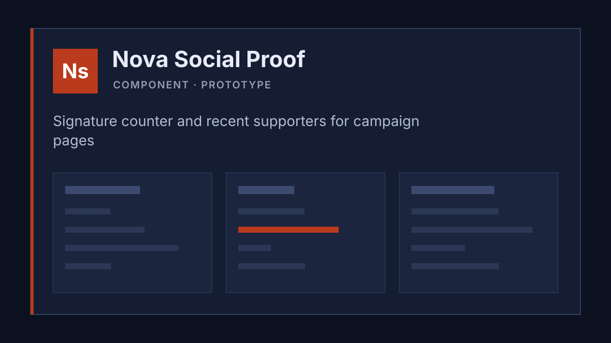

# Project Dashboard

Open-source meta project that documents, connects and visualizes all your active projects as a single-page HTML dashboard. Claude Code sets it up and keeps it current; this file is its instruction set.

Communication language: English (switch to the user's language if they write in another one).

## Architecture

- **index.html**: the complete dashboard in one file (HTML, CSS, JS, no framework, no build step). Open it with `file://` in any browser.
- **Kernmix** (embedded in `index.html` between `<!-- KERN-SYSTEM:BEGIN … -->` and `<!-- KERN-SYSTEM:END -->`): design system on top of the open standard KERN. KERN-Kit 2.8.2, Kernmix tokens and components (`km-` prefix), theme “Kobalt”, the scripts `km-table.js` and `km-popup.js`. **Never edit this block by hand.** Page-specific CSS follows after the block and only uses `--km-*` tokens.
- **scan.sh**: measures projects (files, lines, last change, hours from Claude Code sessions, CLAUDE.md and memory, tasks, links). It only prints; Claude Code copies the values into `index.html`. Root folder: `PD_CODE_DIR` (default `~/projects`). Needs macOS (`stat -f`, BSD `date`).
- **sync-tasks.py**: rewrites the task cards between `<!-- AUTO-TASKS:BEGIN … -->` and `<!-- AUTO-TASKS:END -->` from `tasks/*.md`. Standard library only.
- **tools/make-social-images.py**: renders a 1200×630 share image per project into `assets/social/` with headless Chrome and rewrites the JSON block between `<!-- SOCIAL-I:BEGIN -->` and `<!-- SOCIAL-I:END -->`. Chrome path via `CHROME`, otherwise the macOS default or `google-chrome`/`chromium`.
- **tasks/**, **templates/ticket.md**, **tasks.base**, **obsidian-color-code.md**: tickets, ticket template, optional Obsidian kanban view and color code.
- **assets/**: `previews/<project-id>.svg|png` (card previews), `social/` (share images), `fonts/` (Atkinson Hyperlegible Next, OFL), `readme/` (README images), `social-preview.png`, `linkedin.png`.
- **README.md**, **CHANGELOG.md** (add an entry for every release), **LICENSE** (EUPL-1.2), **LICENSES/**, **NOTICE.md** (third-party parts).

## Structure of index.html

1. `<head>`: small start scripts (theme, saved demo state), the Kernmix block, the font block, page styles.
2. `<header class="km-header">`: logo (click resets filters and search), `nav#km-quicklinks` (pinned projects, filled by JS), theme switch.
3. `<div class="layout">` with three columns:
   - `nav#side-nav.km-sidebar`: filter group (status, organizations, types, phase) and one entry per section; collapsible to an icon rail.
   - `main#main-col`: Focus (`#km-focus`), Lists (`#listen`), About (`data-section="about"`), Project overview (`data-section="overview"`, `table#overview-table`), Project details (`data-section="details"`, `.projects` with one `article.project` per project), Skills (`#skills`), Ideas (`#ideen`), Shortcuts (`#shortcuts`).
   - `aside#sidebar`: Tasks (`#global-tasks`, cards in `#manual-tasks`) and Synergies (`data-section="synergies"`).
4. `footer.km-footer`: live counts, layout reset, last viewed and last update.
5. Scripts: table sorting and grouping, search, filters for all sections, lists, focus, quicklinks, stars and completed, drag and drop of sections and rows, task cards, share-image preview, keyboard shortcuts (`/`, `t`, `a`, `1`–`3`, `Esc`).

Sections that can be reordered carry `class="sortable-section"` and a unique `data-section`. Internal keys stay as they are even where they are German words (`data-state="offen"`, `data-prio="hoch"`, `km-pill--prototyp`, `id="listen"`, `id="ideen"`): scripts and stored state depend on them.

## Bootstrap: setting up the dashboard for the user's projects

The user says something like “Set up this dashboard for my projects. My code lives in ~/projects”. Then:

1. **Find projects.** Folders in the code root with `.git/`, `CLAUDE.md`, `package.json`, `README.md` or `src/`. Ask which ones to include and to which organization (client, team, “Personal”) each belongs.
2. **Measure.** `PD_CODE_DIR=<root> ./scan.sh` and read the section `=== TABLE VALUES ===` (scope, files, last update, hours per project).
3. **Replace the demo data** in `index.html`:
   - overview rows, grouped under one `org-header` row per organization (pattern below);
   - one project card per project in `.projects`, with description, a panel with next steps and a document table;
   - task cards: write one ticket per open task to `tasks/` and run `python3 sync-tasks.py`;
   - synergy cards in the synergies section;
   - ideas as idea cards in `#ideen`;
   - skills and shortcuts (see below), or remove the two sections and their entries in `#side-nav`.
4. **Colors and monograms.** One color per organization (contrast of white text on it at least 4.5:1), a two-letter monogram per project, both in the `data:` SVG of `img.km-monogram` (copy an existing one and change `fill` and the text).
5. **Paths.** The launch command is `cd ~/projects/<folder> && claude`; search `index.html` for `~/projects/` and replace the root if the user's code lives elsewhere.
6. **Previews and share images (optional).** Screenshot or SVG per project in `assets/previews/<project-id>.svg|png`, then `python3 tools/make-social-images.py`.
7. **Agents (optional).** Create Cockpit, Radar and Bridge in `~/.claude/agents/` (definitions below).
8. **Demo state and Obsidian.** Remove the first `<script>` in `<head>` that seeds the demo stars, pins and quicklinks (`pd-demo-saat-v1`) once the demo projects are gone. Obsidian links use the vault name `projects` (`obsidian://open?vault=projects…`, `advanced-uri?vault=projects`); replace it with the name of the user's vault, or leave it if they do not use Obsidian. The header button for Obsidian live sync is optional and only writes ticket files for cards that carry `data-file`.
9. **Check.** Open nothing, start no server; render headless if a browser is available, otherwise parse the file: balanced `<div>` and `<details>`, every `href="#…"` points to an existing id, no German demo text left if the user wants English, no personal paths (`/Users/…`) in files the user wants to publish.

### Header buttons: capture idea, temp project, new project

The three buttons in the header copy a command that starts Claude Code in the dashboard folder (`cd ~/projects/project-dashboard && claude "…"`). What to do for each request:

- **“Capture an idea …”**: ask for a short description, then add an idea card in `#ideen` (pattern below, `id="idea-<slug>"`, first badge “Idea”). No project folder, no table row. If the idea has a concrete next step, also write a ticket in `tasks/` and run `python3 sync-tasks.py`.
- **“Create a temporary work project …”**: for short jobs such as a review or a ticket. Create `~/projects/_temp/<slug>/` with a `CLAUDE.md` (task, sources, status), no memory folder, no `scan.sh` entry, no table row. Show it in the Ideas section as an idea card with the extra class `temp-card`, `id="temp-<slug>"`, indicator `var(--km-color-border-section)`, badges “Temporary” and “Open”, and a line `<p class="km-card__note"><strong>Status:</strong> …</p>`. When the work is done, remove the card; if it grows into a project, follow “New project”.
- **“Add a new project …”**: ask for name, organization, folder and a short description, then: project folder with `CLAUDE.md`, memory folder `~/.claude/projects/<encoded path>/memory/` with `MEMORY.md`, an entry in the `PROJECTS` list of `scan.sh`, a table row under its organization and a project card (patterns below), optionally a preview and a share image.

Ongoing: “Scan my projects and update the dashboard” (Radar), “Find synergies” (Bridge), “Add project X” (row, card, ticket, preview). Every new project needs: project folder, a `CLAUDE.md` in it, a memory folder `~/.claude/projects/<encoded path>/memory/` with `MEMORY.md`, and the dashboard entry.

## HTML conventions

### Overview row

```html
<tr class="org-header km-table__group" style="--org-color:#b93a1c;--km-row-color:#b93a1c"><td colspan="11"><span class="km-table__group-label">Redleaf NGO</span></td></tr>
<tr>
  <td><a class="table-name km-table__name" href="#nova-social-proof">Nova Social Proof</a></td>
  <td>Component</td>
  <td>Redleaf NGO</td>
  <td><div class="table-badges km-chips"><span class="table-badge km-pill km-pill--neutral">Lit</span></div></td>
  <td class="km-table__scope" data-sort="2700">~2.7k lines</td>
  <td data-sort="55">55</td>
  <td class="km-table__date" data-sort="2026-11-05T10:00">2026-11-05 10:00</td>
  <td class="km-table__hours" data-sort="8.5">8.5h</td>
  <td><span class="phase-badge km-pill km-pill--prototyp">Prototype</span></td>
  <td><div class="km-chips"><a class="table-link km-chip km-chip--extern" href="https://…" target="_blank" rel="noopener">Site</a></div></td>
  <td></td>
</tr>
```

`<tr class="work">` marks a project in progress. The last cell stays empty; scripts fill the action buttons. The first row of the table body is the `tool-code` band header; keep it.

### Phases

| Phase | Class |
|---|---|
| Idea | `km-pill--idee` |
| Concept | `km-pill--konzept` |
| Prototype | `km-pill--prototyp` |
| Active | `km-pill--aktiv` |
| Migration | `km-pill--migration` |
| Stable | `km-pill--stabil` |
| Dormant | `km-pill--neutral` |

### Project card

```html
<article class="project km-card km-card--accent-left km-card--collapsible" id="nova-social-proof">
  <div class="project-header km-card__head">
    <div class="project-indicator" style="background: #b93a1c;"></div>
    <div class="project-title-block">
      <div class="project-name project-toggle km-card__title">Nova Social Proof</div>
      <div class="project-subtitle km-card__subtitle">One line</div>
    </div>
    <div class="project-badges km-card__badges"><span class="badge km-pill km-pill--neutral">Lit</span></div>
  </div>
  <div class="project-body km-card__body">
    <p class="project-description">Two or three sentences.</p>
    <div class="km-panels">
      <div class="project-section km-panel"><h4>Next steps</h4><ul><li>…</li></ul></div>
    </div>
    <figure class="cd-preview"></figure>
  </div>
</article>
```

The card id equals the `href` anchor of its table row. Fact tiles (phase, type, scope, files, update, hours) and the action buttons are added by script from the table row.

### Document table (inside the card body)

```html
<details open>
  <summary>Documents &amp; configuration</summary>
  <table class="docs-table km-table km-table--compact">
    <thead><tr><th class="km-table__sort" aria-sort="none" data-sort="text">Type</th><th>Actions</th><th class="km-table__sort" aria-sort="none" data-sort="text">File</th><th>Description</th><th class="km-table__sort" aria-sort="none" data-sort="size">Size</th><th class="km-table__sort" aria-sort="none" data-sort="date">Update</th></tr></thead>
    <tbody>
      <tr><td class="doc-type"><span class="km-pill km-pill--info">Project</span></td><td class="km-table__actions km-table__actions--start"><button class="copy-btn km-iconbtn km-iconbtn--label" data-doc-dir="nova-fluid-type" data-doc-path="README.md">copy</button></td><td>README.md</td><td class="km-table__text">What it is</td><td class="doc-size">4.2&nbsp;KB</td><td class="doc-date">2026-11-06&nbsp;12:21</td></tr>
    </tbody>
  </table>
</details>
```

Types and pills: Project `--info`, Research `--warn`, Code `--ok`, Claude `--neutral`. Sizes via `stat -f '%z'`, dates via `stat -f '%Sm' -t '%Y-%m-%d %H:%M'`. Scripts order the columns and add icons.

### Task card

Written by `sync-tasks.py`; do not edit between the `AUTO-TASKS` markers. Ticket fields: `id`, `title`, `status` (open | active | blocked | waiting | done | dropped), `status_note`, `priority` (high | medium | low), `project` (anchor id), `due` (date or short text), `created`, `summary`, `next`.

### AI task suggestions

The block between `<!-- AI-SUGGESTIONS:BEGIN … -->` and `<!-- AI-SUGGESTIONS:END -->` in the tasks section holds suggested tasks. When the user asks “Suggest next tasks for my projects”, read the open tickets in `tasks/`, each project's status (CLAUDE.md, memory, recent changes from `scan.sh`) and the synergy cards, then replace the cards inside `.km-suggest__list` with three to six suggestions. Each suggestion names one project, a concrete next step, why it matters now and a rough effort; no duplicates of existing tickets. Update the date in `.km-suggest__note`. The Bridge agent can do this as part of a synergy run. Card pattern:

```html
<div class="task-item km-suggest__task km-task" data-project="prism-fluid-type">
  <div class="task-content km-task__body">
    <div class="task-title km-task__title">
      <span>Share the clamp() test page between Nova and Prism</span>
      <span class="km-suggest__tag">AI</span><span class="task-status km-task__status offen km-pill km-pill--info">Suggestion</span>
    </div>
    <div class="task-meta km-task__meta"><a href="#prism-fluid-type" class="proj-link km-link km-link--projekt">Prism Fluid Type</a> &middot; Reason and smallest next step.</div>
  </div>
</div>
```

“Accept” (added by script) moves a suggestion into the task list in the browser; “Put back” returns it. To keep an accepted suggestion, write it as a ticket in `tasks/` and run `python3 sync-tasks.py`.

### Synergy card

```html
<div class="synergy-card km-card">
  <h3><span class="km-dots"><span class="km-dots__dot" style="--km-dot-color:#b93a1c"></span><span class="km-dots__dot" style="--km-dot-color:#005b8e"></span></span> Title</h3>
  <div class="km-card__text"><p>What connects the projects.</p><p><strong>What you get:</strong> …</p><p><strong>Next step:</strong> …</p></div>
  <p class="km-card__meta">As of 2026-11-09</p>
</div>
```

### Idea card

Like a project card with the extra class `idea-card`, `id="idea-<slug>"`, indicator `var(--km-color-accent)` and a first badge “Idea”; no table row.

### Skills and shortcuts

The demo content in `#skills` and `#shortcuts` is static HTML: one `article.skill-card` per skill (`id="skill-<name>"`), the call graph as inline SVG in `details.km-graph` (nodes `g.km-graph__n` with `data-k`, edges `path.km-graph__e` with `data-a`/`data-b`, dashed edges add `km-graph__frage`), and one `article.km-shortcut` card per shortcut. To show the user's own skills, list `~/.claude/skills/*/SKILL.md`, write one card per skill and redraw the graph from the skills that mention other skills by name, keeping the four columns (entry points, brokers, helpers, building blocks). If the user does not use skills or shortcuts, remove both sections and their sidebar entries.

## Agents

| Agent | Model | Tools | Role |
|---|---|---|---|
| Cockpit | inherits the session | Agent(radar, bridge), Read, Edit, Write, Bash, Glob, Grep | coordinates, checks results, updates `index.html` |
| Radar | sonnet | Read, Bash, Glob, Grep, Edit | runs `scan.sh`, updates rows, document tables, hours; reports stale or missing CLAUDE.md and memory |
| Bridge | opus | Read, Bash, Glob, Grep, Edit | compares projects (tokens, components, decisions), writes synergy cards and task suggestions |

Create them as `~/.claude/agents/<name>.md` with frontmatter `name`, `description`, `tools`, `model`. Only Cockpit may start other agents; Radar and Bridge are workers. Cockpit verifies every number and claim before it lands in the dashboard. Start with `claude --agent cockpit` in the dashboard folder, or ask Radar or Bridge directly in a session.

## Rules

- **No server, no build, no CDN.** Everything stays inside `index.html` and `assets/`.
- **Square corners** everywhere (`border-radius: 0`), also in SVG (`rx="0"`).
- **Contrast:** text at least 4.5:1, interface elements at least 3:1, in dark and light.
- **Kernmix first:** new visible elements use existing `km-` components and `--km-*` tokens; no hex colors or pixel values in page CSS except project colors.
- **Icons:** Lucide only (the `lucide-icons` JSON block), no characters like ✓ or ★ as icons.
- **Generated blocks:** never edit between `KERN-SYSTEM`, `AUTO-TASKS` and `SOCIAL-I` markers by hand; `AI-SUGGESTIONS` is written by Claude Code on request.
- **Small, targeted edits** in `index.html`; read the spot first.
- **Releases:** update `CHANGELOG.md` (Added, Changed, Removed) with every release.
- **Licence:** the repository is EUPL-1.2; keep `NOTICE.md` current when third-party parts change.
