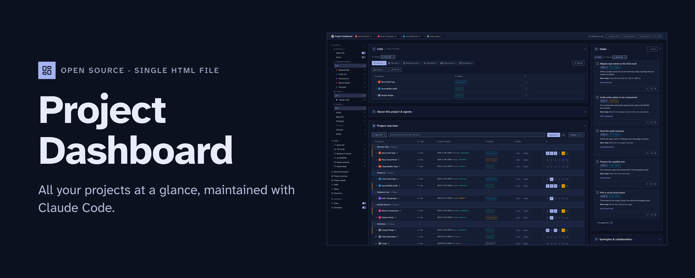
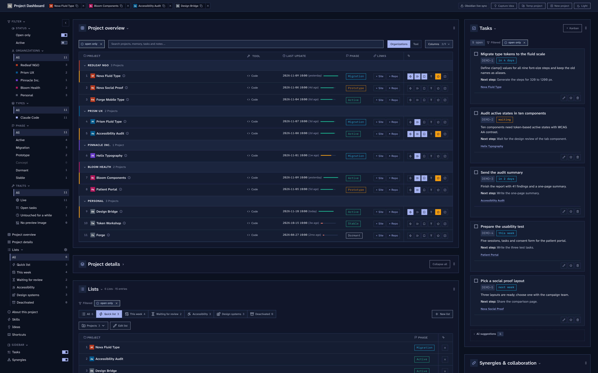
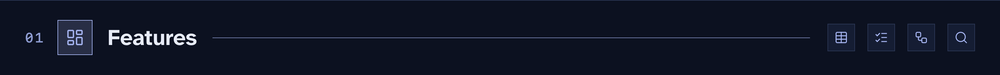
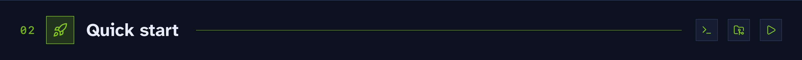
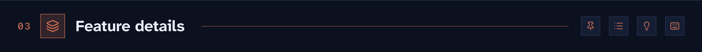
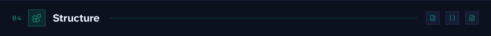
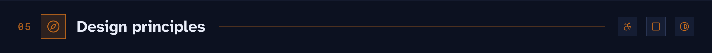
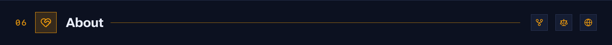

# Project Dashboard

**All your projects at a glance, in one HTML file, maintained with Claude Code.**

The dashboard shows what you are working on, what comes next and where projects can learn from each other. It is a single `index.html`: no server, no account, no build step, no dependencies. Open it in a browser and it works. Claude Code sets it up for your own projects and keeps it current, guided by the `CLAUDE.md` in this repository.

It started as a table with a few project names. Sorting came next, then search, cards, tasks, hours from Claude Code sessions, synergies between projects and three agents that keep the numbers current. Version 3 rebuilds all of it on Kernmix, a design system on top of the open standard [KERN](https://www.kern-ux.de/). The demo ships with twelve fictional projects so you can try every feature before you add your own.

<picture>
  <source media="(prefers-color-scheme: light)" srcset="assets/readme/screenshot-light.png">
  
</picture>

---



## Features

**Overview and details**

- 🗂️ **Project overview**: one numbered row per project: type, organization, tech stack, scope, files, last update with freshness bar, hours, phase and links; grouped by organization, foldable groups, sortable columns.
- 🧮 **Column picker**: show single columns or named sets (Overview, Organizations, Tech, All).
- 🏷️ **Seven phases**: Idea, Concept, Prototype, Active, Migration, Stable, Dormant as colored pills.
- 🃏 **Project details**: one card per project with fact tiles, description, next steps, decisions and a document table; cards grouped like the table, group counts follow the filters.
- 🖼️ **Previews and share images**: a preview image per card and a 1200×630 share image behind the info "i" at the project name.
- 📌 **Focus**: pin up to three projects above everything else.

**Navigate and filter**

- 🧭 **Side navigation**: every section in a collapsible sidebar with an icon-only rail; back and forward in the browser follow your jumps.
- 🎛️ **Filters for all sections**: organizations, types, phase, "Open only" and "Active", each with "All" and live counts; one filter applies to overview, details, tasks, synergies, lists and focus.
- ✖️ **Filter chips**: every filtered section shows the active filters; × removes one.
- 🔎 **Search with field filters**: weighted search over rows, cards, tasks and synergies; `-word`, `"exact phrase"`, `person:`, `tag:`, `org:` and `in:field`, with suggestions on focus.
- ⬆️ **Back to top**: one click from anywhere in a long column.

**Organize**

- 📋 **Lists**: your own lists with an icon picker, rename and delete, a one-click quick list from every row, a "Deactivated" list and a list filter for the overview.
- 🔗 **Quicklinks**: pin projects to the header; a click copies `cd … && claude` for that project.
- ⭐ **Star and complete**: mark projects as in progress or completed; completed projects dim and their tasks are deactivated.
- ✋ **Drag and drop**: reorder sections, organizations, table rows, quicklinks and task cards; the order is remembered.
- ✅ **Tasks**: cards from Markdown tickets with details dialog, star, reorder and check off; kanban view in Obsidian via `tasks.base`.
- 💬 **AI task suggestions**: suggested next tasks with a reason, generated by Claude Code from your project state; accept one as a task or put it back.
- 🔄 **Obsidian live sync (optional)**: write task changes back into the ticket files.
- 🤝 **Synergies**: cards that name a connection between projects, what you get from it and the next step.
- 💡 **Ideas**: a card for each idea before it becomes a project.

**Work with Claude Code**

- 🚀 **Header buttons**: "Capture idea", "Temp project" and "New project" copy a ready command that starts Claude Code in the dashboard folder; `CLAUDE.md` says what to do.
- 🧩 **Skills with call graph**: every skill with its purpose and scope, plus a graph of which skill calls which.
- ⌘ **Shortcuts**: prompt shortcuts such as `+lg` or `+vc`, what they do and in which order they run.
- 🤖 **Three agents**: Cockpit coordinates, Radar measures, Bridge finds synergies.
- ℹ️ **About section**: animated graphics that explain how the dashboard is made and how the agents work together.
- 🛠️ **Helper scripts**: `scan.sh` measures projects and hours, `sync-tasks.py` builds the task cards, `tools/make-social-images.py` renders share images.
- ⏱️ **Hours**: per project from `time-log.md`, manual entries plus Claude Code session times.

**Look and feel**

- 🌗 **Light and dark**: Kernmix theme "Kobalt", square corners, Lucide icons, the font Atkinson Hyperlegible Next.
- ♿ **Accessible**: keyboard operable, visible focus, contrast measured in both themes, motion only when the system allows it.
- ⌨️ **Keyboard shortcuts**: `/` search, `t` theme, `a` tasks, `1` `2` `3` view modes, `Esc` closes panels.


---



## Quick Start

### 1. Clone and open the demo

```bash
git clone https://github.com/donludwig/project-dashboard.git
cd project-dashboard
open index.html
```

### 2. Let Claude Code set it up

```bash
claude
```

Then say:

```
Set up this dashboard for my projects. My code lives in ~/projects
```

Claude Code reads `CLAUDE.md` and will:

1. Find your project folders and measure them with `scan.sh`
2. Replace the demo projects with yours: table rows, cards, document tables
3. Pick a color, a two-letter monogram and a phase for each project
4. Turn your tickets into task cards with `sync-tasks.py`
5. Look for synergies between your projects
6. Optionally create the three agents and your own skills and shortcuts

### 3. Keep it current

- "Scan my projects and update the dashboard"
- "Add project X to the dashboard"
- "Find synergies between my projects"

---



## Feature Details

### One file

Everything lives in `index.html`: the Kernmix design system between the `KERN-SYSTEM` markers, the page styles, the content and the scripts. State that you change in the browser (order, filters, lists, stars, theme) is stored in `localStorage`; nothing is sent anywhere.

### Tasks from ticket files

Tickets are Markdown files with frontmatter in `tasks/`:

```yaml
---
id: DEMO-1
title: "Migrate type tokens to the fluid scale"
status: open          # open | active | blocked | waiting | done | dropped
status_note: ""
priority: high        # high | medium | low
project: nova-fluid-type
due: "in 4 days"      # a date (2026-11-13) or a short text
created: 2026-11-09
summary: "Define clamp() values for all nine font-size steps and keep the old names as aliases."
next: "Generate the steps for 320 to 1200 px."
---
```

`python3 sync-tasks.py` rewrites the task cards between the `AUTO-TASKS` markers. Done and dropped tickets are skipped. `tasks.base` gives you a kanban view in Obsidian, `templates/ticket.md` is the template.

### Skills and shortcuts

The skills section lists the skills Claude Code can use, with a graph of who calls whom. The shortcuts section explains prompt shortcuts: `+` plus two letters anywhere in the prompt, run in a fixed order (content, check, output, publish). The demo shows fifteen example skills and eight shortcuts; replace them with your own.

### Agents

| Agent | Model | Does | Delivers |
|---|---|---|---|
| Cockpit | same as the session | starts Radar and Bridge, checks their results, applies them | a verified, current dashboard |
| Radar | Sonnet | reads all project folders: files, lines, last change, hours, CLAUDE.md, memory | numbers, document tables, hints about stale notes |
| Bridge | Opus | compares project content: tokens, components, decisions | synergy cards and task suggestions |

Start Cockpit with `claude --agent cockpit` in the dashboard folder. `CLAUDE.md` contains the agent definitions.

### Hours

Each project can keep a `time-log.md` with manual entries and Claude Code sessions. `scan.sh` reads the session logs in `~/.claude/projects/`, computes active time without breaks and prints the totals for the hours column.

### Share images and previews

`python3 tools/make-social-images.py` renders a 1200×630 image per project into `assets/social/` and updates the `social-images` block in `index.html`. Card previews live in `assets/previews/<project-id>.svg` (or `.png`).

---



## Structure

```
index.html              the dashboard (HTML, CSS, JS, embedded Kernmix)
CLAUDE.md               instructions for Claude Code: setup, conventions, agents
scan.sh                 measures projects, hours, tasks and links (prints only)
sync-tasks.py           task cards from tasks/*.md
tools/make-social-images.py   share images per project
tasks/                  demo tickets
tasks.base, templates/  Obsidian kanban view and ticket template
obsidian-color-code.md  optional color code for tickets and highlights
time-log.md             example hours log
assets/                 previews, share images, font, README images
LICENSE, LICENSES/, NOTICE.md   EUPL-1.2 and third-party licences
CHANGELOG.md            release notes
```

---



## Design Principles

- **One file, no dependencies**: no npm, no CDN, no build, works offline.
- **Accessible by default**: keyboard operable, visible focus, contrast measured in both themes, motion only when the system allows it.
- **Built on a standard**: components from Kernmix on top of the open KERN standard instead of one-off CSS.
- **Made for Claude Code**: Claude Code sets it up and keeps it current from `CLAUDE.md`.
- **Your data stays local**: everything you change lives in your browser.

Inspired by the [Spine Pattern](https://tsoporan.com/blog/spine-pattern-multi-repo-ai-development/), design system documentation and personal knowledge management tools.

---



## About

Made by Don Ludwig ([@donludwig](https://github.com/donludwig)), a freelance UX/UI designer from Berlin. I work on design systems, interface design, and accessibility for civic, cultural, and public-sector teams, close to the code and in conversation with the developers who build it. I also contribute to [KERN](https://www.kern-ux.de/), the open design system standard of the German public administration.

[LinkedIn](https://www.linkedin.com/in/donludwig/) · [don@thinkrepeat.com](mailto:don@thinkrepeat.com) · [thinkrepeat.com](https://thinkrepeat.com/)

## License

[EUPL-1.2](LICENSE) (European Union Public Licence). Third-party parts (Kernmix, KERN-Kit, Lucide, Atkinson Hyperlegible Next) are listed in [NOTICE.md](NOTICE.md).
